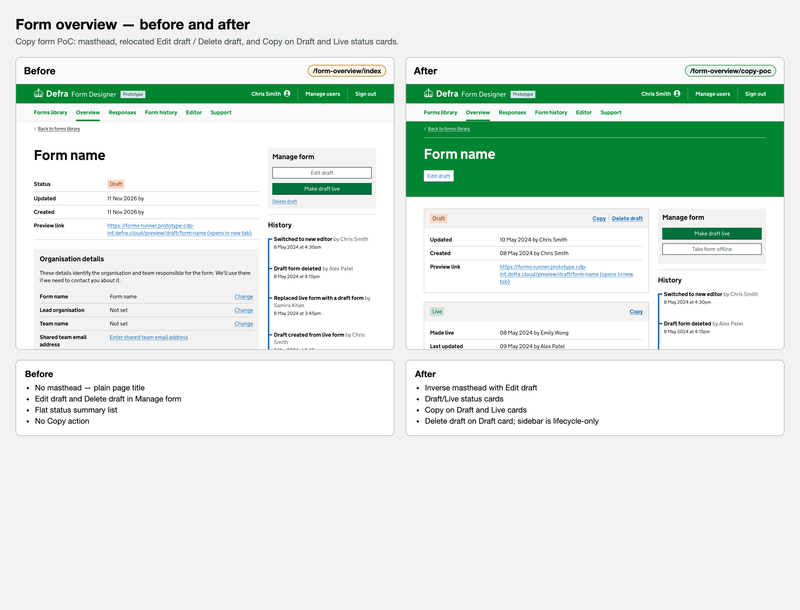
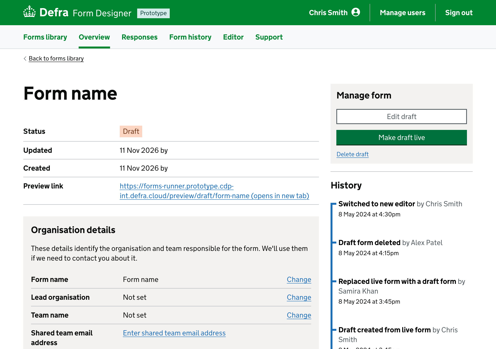
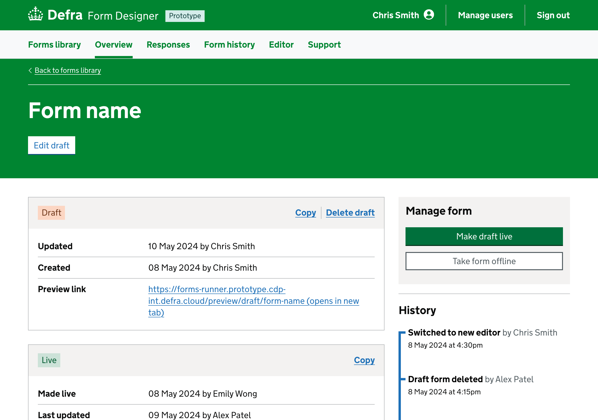
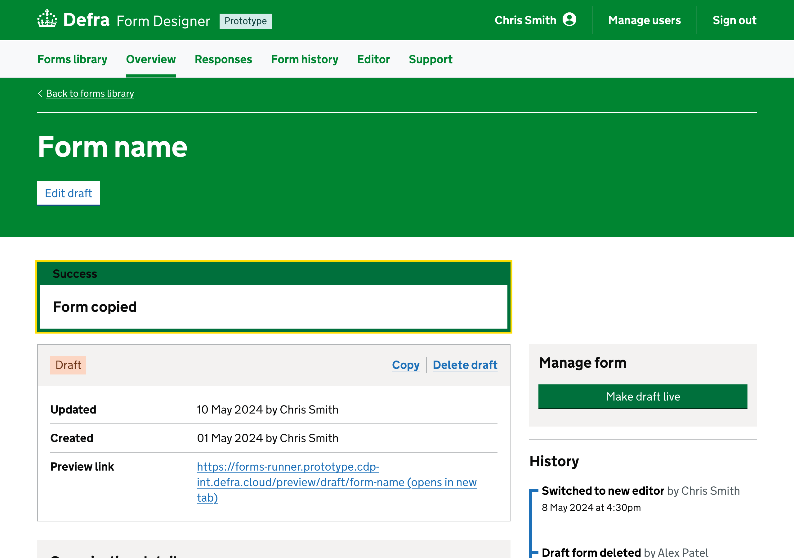

# Form overview changes (copy form PoC) — before and after

**Scope:** Layout and action changes introduced for the copy-form proof of concept  
**Before:** `/titan-mvp-1.2/form-overview/index/` (`_base-overview.html` + `_form-status.html`)  
**After:** `/titan-mvp-1.2/form-overview/copy-poc` (`_base-overview-copy-poc.html` + `_form-status-copy-poc.html`)  
**Date:** 11 Nov 2026  
**Related:** [customer-journey-map-copy-form.md](./customer-journey-map-copy-form.md), [copy-form-form-history-and-irt-metrics.md](./copy-form-form-history-and-irt-metrics.md)

---

## Before and after (side by side)



Editable HTML version: [`form-overview-before-after/before-after-combined.html`](form-overview-before-after/before-after-combined.html)

---

## At a glance

| Change | Before | After |
|---|---|---|
| Page title / hero | Plain `h1` in content | Green inverse **masthead** with form name |
| Back link | `beforeContent` above content | Inside masthead (inverse back link) |
| Edit draft | Manage form sidebar (secondary button) | Masthead primary inverse button |
| Delete draft | Manage form sidebar link | Draft status **card** action |
| Copy form | Not present | **Copy** on Draft and/or Live status cards |
| Status UI | Flat summary list with Status row | Summary **cards** (Draft / Live) with actions |
| Manage form sidebar | Edit draft, Make live, Delete draft (and live variants) | Lifecycle actions only: Make live / Create draft / Take offline |
| Copy success | N/A | Success notification banner on overview |

---

## Before



**Prototype:** http://localhost:3000/titan-mvp-1.2/form-overview/index/

### Layout

- Service header + nav only (no masthead).
- Back link sits above a content `h1` (“Form name”).
- Status is a flat GOV.UK summary list including a Status tag row.
- Right rail **Manage form** holds Edit draft, Make draft live, Delete draft.
- History timeline remains in the right rail.

### Why this was limiting for copy

- No clear place for **Copy draft** vs **Copy live** when both exist.
- Edit / delete / publish were mixed in one sidebar, so adding Copy would clutter lifecycle actions.
- Title hierarchy was weaker than editor pages that already use a masthead.

---

## After



**Prototype:** http://localhost:3000/titan-mvp-1.2/form-overview/copy-poc

### 1. Masthead

Added `x-govuk-masthead x-govuk-masthead--large x-govuk-masthead--inverse` in the header block:

- Inverse back link: Back to forms library  
- Form name as masthead title  
- **Edit draft** as an inverse button in the masthead when a draft exists (`Draft`, `Draft-Live`, `Live-Draft`)

### 2. Status cards + relocated actions

Replaced the flat status summary list with GOV.UK **summary cards**:

| Card | Actions moved / added |
|---|---|
| **Draft** | **Copy** (new), **Delete draft** (moved from sidebar) |
| **Live** | **Copy** (new) |

Status tag sits in the card title; metadata (updated/created/preview or made live/live link) stays in the card body. The separate “Status” row is no longer needed because the card title carries the tag.

### 3. Manage form sidebar (simplified)

Sidebar keeps **lifecycle** actions only:

| Form state | Sidebar actions (after) |
|---|---|
| Draft | Make draft live |
| Live | Create draft to edit, Take form offline |
| Draft + Live | Make draft live, Take form offline |

Removed from sidebar (moved elsewhere):

- Edit draft → masthead  
- Delete draft → Draft card actions  

### 4. Copy success state

When returning from Make a copy:



- Success banner: e.g. `Live form copied as “…. The copy is a draft.`  
- User is on the **new** draft overview (session swapped to the copy)

---

## Action map (where things live now)

```text
Masthead
  └─ Edit draft

Draft status card
  ├─ Copy  → /form-overview/copy-form?source=draft
  └─ Delete draft

Live status card
  └─ Copy  → /form-overview/copy-form?source=live

Manage form (sidebar)
  ├─ Make draft live
  ├─ Create draft to edit   (live only)
  └─ Take form offline      (live / draft+live)
```

---

## Design rationale

1. **Masthead** aligns overview with editor-style hierarchy and makes the form name a hero-level signal.  
2. **Edit draft** in the masthead is the primary “continue working” action.  
3. **Copy** sits on the version it copies (draft card vs live card), which makes source choice explicit for IRT and users.  
4. **Delete draft** belongs with draft management on the draft card, not with publish/offline.  
5. **Manage form** stays focused on go-live / offline lifecycle.

---

## Files

| Role | Path |
|---|---|
| Before base layout | `app/views/titan-mvp-1.2/form-overview/includes/_base-overview.html` |
| After base layout | `app/views/titan-mvp-1.2/form-overview/includes/_base-overview-copy-poc.html` |
| Before status | `app/views/titan-mvp-1.2/form-overview/includes/_form-status.html` |
| After status + Copy | `app/views/titan-mvp-1.2/form-overview/includes/_form-status-copy-poc.html` |
| After page entry | `app/views/titan-mvp-1.2/form-overview/copy-poc.html` |
| Screenshots | `docs/form-overview-before-after/` |

---

## Open questions / follow-ups

- Should Take form offline stay secondary-quiet in the sidebar, or move nearer the Live card?  
- When only Live exists (no draft), should masthead show Create draft instead of Edit draft? (Currently Edit draft is draft-only.)  
- Promote copy-poc layout into the main overview once research validates Copy placement.
